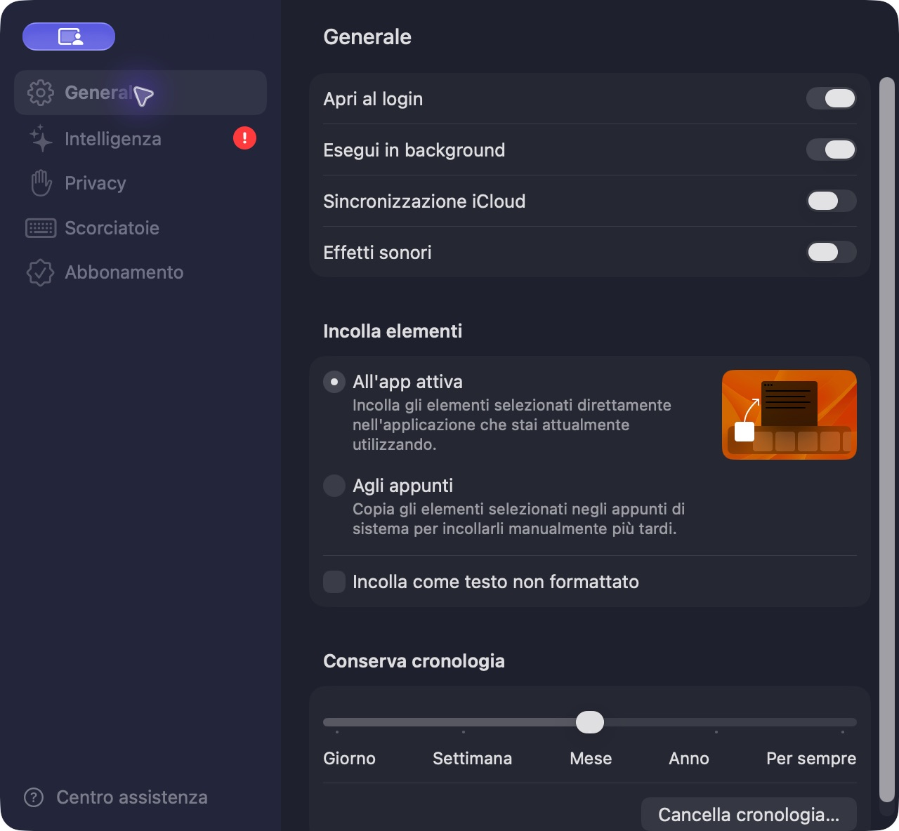
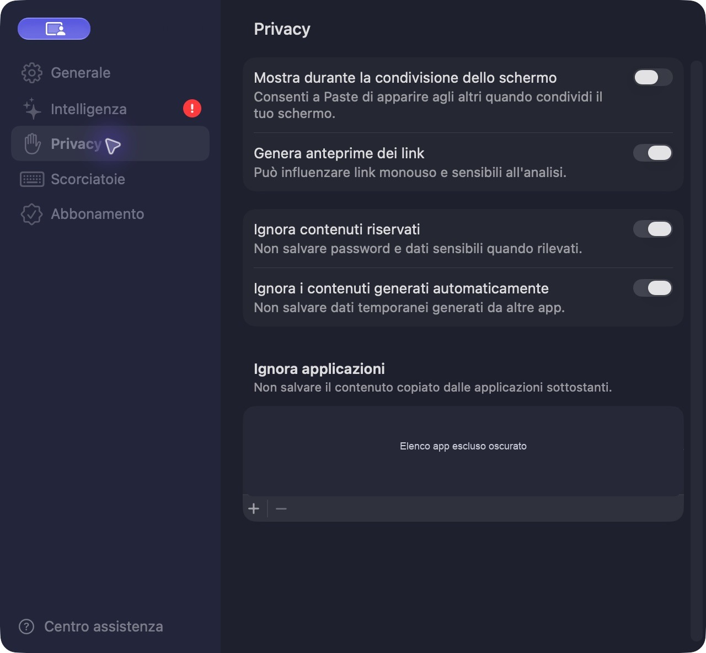
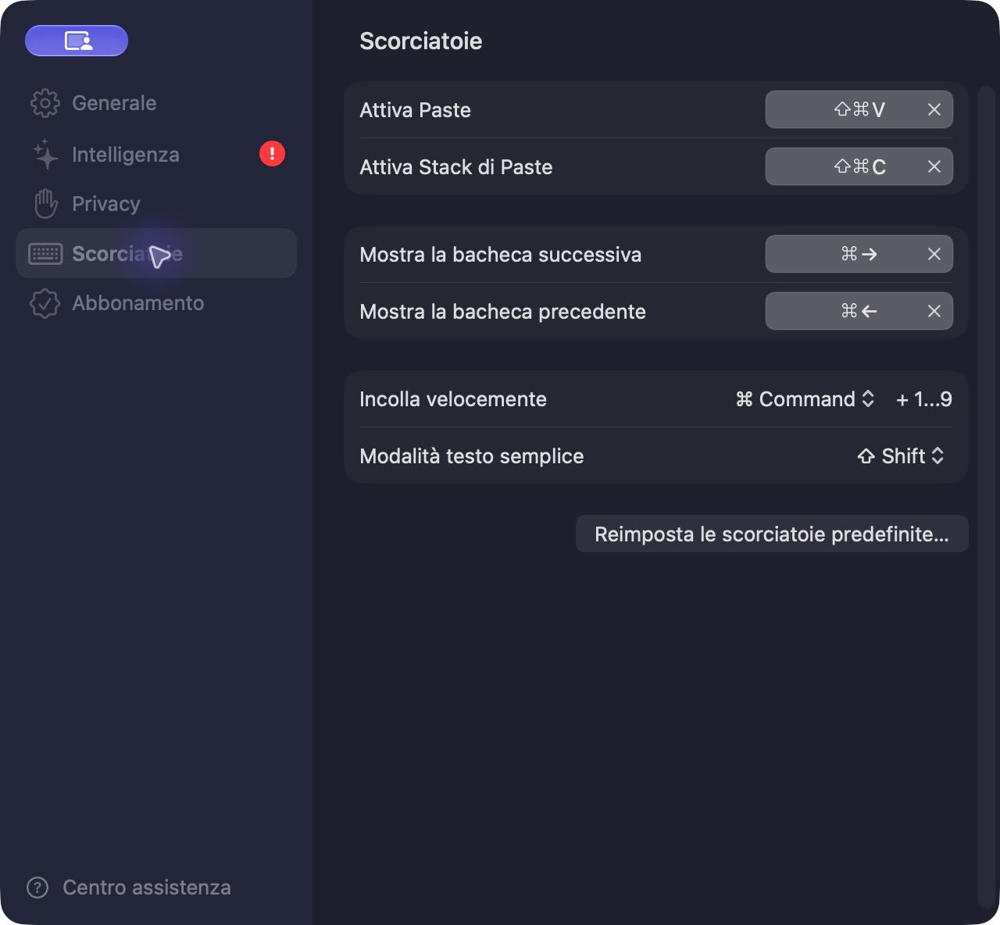

# Specifica di prodotto e UX: OpenPaste

**Stato:** specifica di riferimento  
**Aggiornata:** 4 ottobre 2026  
**Riferimento osservato:** Paste per macOS, schermate e preferenze disponibili sul Mac  
**Scopo:** tradurre il modello d’uso di Paste in requisiti e direzione di design per OpenPaste, mantenendo un’identità propria.

## 1. Obiettivo

OpenPaste deve rendere recuperabile e riutilizzabile ciò che l’utente copia, richiamando una cronologia contestuale da qualsiasi app. Il flusso principale deve essere rapido: aprire il pannello con una scorciatoia globale, trovare un elemento, inserirlo nell’app attiva e tornare al lavoro.

La scorciatoia iniziale proposta è **⇧⌘V** (Shift–Command–V), modificabile nelle impostazioni. Deve essere mostrata nei menu e nelle schermate di aiuto con la combinazione effettivamente configurata.

## 2. Riferimento: funzioni osservate in Paste

Questa sezione registra ciò che è stato visto nell’app di riferimento, non garantisce che ogni funzione sia già presente in OpenPaste.

- Attivazione globale, configurabile; ⇧⌘V è il valore predefinito visualizzato.
- Finestra di cronologia con ricerca e filtri, elementi recenti e organizzazione per bacheche.
- Creazione di bacheche; passaggio alla bacheca successiva/precedente da tastiera.
- Elementi riconoscibili per tipo, tra cui testo, link e file; anteprime e dettagli contestuali.
- Incolla nella app attiva oppure copia l’elemento scelto negli appunti di sistema per incollarlo manualmente.
- Incolla rapido degli elementi numerati 1–9; opzione per incollare come testo semplice.
- Pausa temporanea della raccolta, con durate rapide.
- Preferenze per apertura al login, esecuzione in background, sincronizzazione iCloud, suoni e conservazione della cronologia.
- Controlli privacy per schermata condivisa, anteprime dei link, contenuti riservati, dati temporanei e app da escludere.
- Suggerimenti contestuali di Appunti intelligenti, descritti nell’interfaccia come elaborati sul Mac, con controllo per l’accesso allo schermo.
- Collegamento opzionale di strumenti di IA tramite MCP, disattivato per impostazione iniziale nell’interfaccia osservata.

## 3. Stato attuale di OpenPaste

Alla data di aggiornamento, il README e il codice esistente documentano quanto segue:

- Acquisizione mentre OpenPaste è in esecuzione e salvataggio locale di testo e link HTTP/HTTPS.
- Database SQLite con GRDB, deduplicazione, aggiornamento degli elementi ricopiati e ricerca full-text.
- Cronologia, raccolte, assegnazione degli elementi e conservazione configurabile.
- Recupero asincrono di titolo e descrizione dei link.
- Nessun supporto attuale per immagini, file, sincronizzazione, collaborazione o filtri per app sorgente.
- La finestra esistente espone cronologia/raccolte, campo di ricerca, selezione retention e azioni contestuali. Il richiamo globale e il flusso di incolla in un’altra app sono obiettivi di prodotto da progettare e implementare.

## 4. Direzione UX

### Pannello di richiamo

Progettare una finestra flottante compatta che possa aprirsi sopra l’app in uso senza costringere l’utente a cambiare contesto.

1. All’apertura, il cursore è già nel campo di ricerca.
2. La vista iniziale mostra i contenuti più recenti, con la selezione sulla copia più recente.
3. L’utente può filtrare per tipo e restringere la vista a Cronologia o a una raccolta/bacheca.
4. Le righe o schede mostrano un’anteprima utile, tipo di contenuto, app sorgente se disponibile e orario/data.
5. La freccia su/giù cambia selezione; Return incolla; Escape chiude.
6. Dopo l’azione, il pannello si chiude e il focus ritorna all’app precedente.
7. Un comando alternativo copia negli appunti di sistema senza simulare l’incolla nell’app attiva.
8. Le scorciatoie per incolla rapido scelgono gli elementi 1–9 nell’ordine visibile e sono annunciate nell’interfaccia.

### Organizzazione

- Distinguere chiaramente **Cronologia** dalle raccolte create dall’utente.
- Consentire di assegnare o spostare un elemento in una raccolta, rimuoverlo dalla cronologia e cancellarlo definitivamente.
- Rendere la cancellazione definitiva esplicita e confermare le azioni distruttive.
- Mantenere ricerca, filtro e raccolta selezionata coerenti quando la lista si aggiorna.

### Aspetto e accessibilità

- Seguire i controlli e le convenzioni macOS; supportare tema chiaro/scuro e dimensioni finestra compatte.
- Usare icone e testo insieme per distinguere il tipo di contenuto.
- Garantire navigazione completa da tastiera, focus evidente, etichette VoiceOver e contrasto adeguato.
- Definire stati vuoti per primo avvio, raccolta vuota e ricerca senza risultati.
- Comunicare in modo breve quando la raccolta è in pausa, quando non è disponibile l’inserimento diretto o quando un contenuto non è supportato.

## 5. Requisiti funzionali proposti

### P0 — Flusso essenziale

- Registrare una scorciatoia globale personalizzabile, inizializzata a ⇧⌘V.
- Rilevare conflitti con combinazioni di sistema o altre app e offrire una scelta alternativa.
- Aprire/chiudere il pannello e gestire ricerca, selezione da tastiera, Escape e incolla.
- Incollare l’elemento selezionato nell’app attiva; offrire anche “Copia negli appunti”.
- Conservare localmente testo e link, con deduplicazione, ricerca, retention e raccolte già previste dal progetto.
- Permettere pausa/ripresa della raccolta con indicatore visibile.
- Avviare la raccolta solo dopo un avvio esplicito dell’app e rispettare lo stato di pausa.

### P1 — Sicurezza e controllo

- Preferenza per ignorare app sorgente selezionate e contenuti temporanei o sensibili.
- Impostazione per non mostrare il pannello durante la condivisione schermo.
- Controlli distinti per anteprime dei link e durata di conservazione.
- Azione per cancellare cronologia e raccolte con riepilogo chiaro dell’effetto.
- Possibilità di incollare come testo semplice.
- Spiegare in modo trasparente quando i metadati dei link richiedono una richiesta al sito di destinazione.

### P2 — Estensioni da valutare

- Supporto a immagini e file, con anteprime, limiti e regole di conservazione proprie.
- Incolla rapido numerato e navigazione tra raccolte da tastiera.
- Sincronizzazione tra dispositivi, solo con scelta esplicita e spiegazione dei dati trasferiti.
- Suggerimenti contestuali locali e integrazione MCP opzionale, disattivati di default e accompagnati da autorizzazioni granulari.
- Suoni e avvio al login come preferenze facoltative.

## 6. Modello d’interazione e scorciatoie

| Azione | Combinazione iniziale proposta | Comportamento |
|---|---|---|
| Apri Paste | ⇧⌘V | Mostra il pannello e mette il focus sulla ricerca |
| Chiudi pannello | Escape | Chiude e restituisce il focus all’app precedente |
| Seleziona elemento | ↑ / ↓ | Sposta la selezione nella lista |
| Incolla elemento | Return | Incolla nell’app attiva e chiude il pannello |
| Copia elemento | Comando secondario nel pannello | Copia negli appunti senza inviare input all’app attiva |
| Incolla rapido | ⌘1…⌘9, da definire | Inserisce l’elemento corrispondente nell’ordine mostrato |
| Testo semplice | ⇧ con incolla rapido, da definire | Rimuove la formattazione quando il tipo lo consente |

Le combinazioni secondarie sono proposte sulla base del modello osservato in Paste e vanno verificate contro le scorciatoie macOS e delle app più comuni prima dell’implementazione. La schermata impostazioni deve consentire modifica, rimozione e ripristino dei valori iniziali.

## 7. Privacy e comportamento dei dati

- Dichiarare chiaramente che cosa viene acquisito, quando la raccolta è attiva, dove sono conservati i dati e come eliminarli.
- Favorire l’elaborazione e la conservazione locali per le funzioni che non richiedono rete.
- Escludere password e contenuti sensibili quando possibile; offrire una lista di app ignorate e un comando pausa facilmente raggiungibile.
- Non salvare nel documento esempi o contenuti reali copiati dagli appunti dell’utente.
- Richiedere consenso esplicito prima di abilitare sincronizzazione o accesso di strumenti esterni.
- Per anteprime web, limitare le richieste a URL pubblici e non inoltrare cookie o credenziali.
- Se l’app non può rilevare in modo affidabile una condizione di privacy, descrivere il limite invece di promettere protezione automatica.

## 8. Criteri di accettazione del flusso principale

- Da un’altra app, ⇧⌘V apre il pannello senza interrompere il contenuto selezionato nell’app sorgente.
- Digitando una parola, la lista si aggiorna e mostra risultati pertinenti.
- La navigazione e l’incolla funzionano senza mouse.
- Dopo l’incolla, il contenuto selezionato arriva all’app che aveva il focus prima dell’apertura.
- Se l’incolla diretto non è disponibile, l’utente può copiare l’elemento e incollarlo manualmente.
- Una combinazione già occupata viene segnalata; l’utente può registrare e verificare una nuova combinazione.
- Durante la pausa non vengono acquisiti nuovi elementi e l’interfaccia rende evidente lo stato.
- La cancellazione distingue “rimuovi dalla cronologia” da “elimina definitivamente”.
- Il primo avvio, la ricerca senza risultati e una raccolta vuota hanno messaggi e azioni successivi comprensibili.

## 9. Decisioni da prendere prima delle funzioni P1/P2

- Tecnica e limiti di macOS per l’inserimento nell’app attiva e per la registrazione della scorciatoia globale.
- Strategia per riconoscere dati sensibili senza introdurre falsi positivi eccessivi.
- Modello dati, limiti di dimensione e retention specifici per immagini e file.
- Se la sincronizzazione rientra nell’ambito del prodotto e quale infrastruttura usa.
- Se i suggerimenti intelligenti e l’accesso MCP sono coerenti con il posizionamento e il modello di minaccia di OpenPaste.

## 10. Riferimenti interni

- Implementazione e stato aggiornato: [README.md](../README.md).
- Riferimento di prodotto osservato: Paste per macOS, schermate disponibili sul Mac il 4 ottobre 2026.

## 11. Schermate di riferimento

Le schermate seguenti sono state acquisite in Paste per macOS il 4 ottobre 2026. Documentano l’interfaccia di riferimento e non rappresentano la UI attuale di OpenPaste.

### Generale

Include avvio al login, esecuzione in background, sincronizzazione, modalità d’incolla e retention.

### Intelligenza

Mostra gli Appunti intelligenti, il relativo accesso allo schermo e l’opzione MCP.

### Privacy

Mostra i controlli per condivisione schermo, anteprime dei link e contenuti da ignorare. I nomi delle app escluse sono stati oscurati prima di salvare l’immagine.

### Scorciatoie

Mostra la combinazione ⇧⌘V per attivare Paste, i comandi per bacheche e le opzioni di incolla rapido.

La schermata della cronologia non è inclusa: al momento della cattura mostrava appunti reali e non era possibile ottenere un’immagine pulita tramite la cattura dell’app. I relativi requisiti restano descritti nelle sezioni precedenti.
